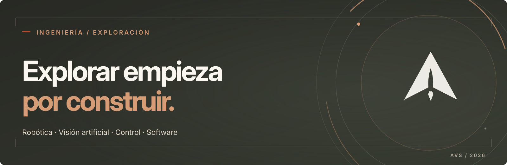

  

### Hola, soy Andrés.

Ingeniero informático, con experiencia en software para sistemas técnicos del sector espacial y ampliando mi formación en **robótica**. Me interesa conectar **percepción, control y desarrollo de software** para crear sistemas capaces de actuar en entornos reales.

> Explorar, experimentar, validar e iterar. El futuro también se construye.

**Áreas de interés** · Robótica autónoma · Computer Vision · Control Systems · Software Engineering · Space Systems

[LinkedIn](https://www.linkedin.com/in/andres-vine-sanchez/) · [Proyectos](#proyectos-seleccionados)

---

### Proyectos seleccionados

**01 / COMPUTER VISION — Reconocimiento de señales de tráfico**  
Prototipo de percepción en vídeo: segmentación HSV, detección de regiones candidatas, clasificación con CNN y validación temporal de predicciones.  
`Python` · `OpenCV` · `TensorFlow` · `Keras` · `GTSRB`

**02 / CONTROL SYSTEMS — Modelado y regulación automática**  
Modelado de sistemas dinámicos y evaluación de controladores P, PI y PID mediante simulación y análisis de respuesta temporal.  
`MATLAB` · `Simulink` · `PID` · `Dynamic Systems`

**03 / SOFTWARE ENGINEERING — Power Meter UI**  
Aplicación de escritorio para instrumentación Keysight: medidas, calibración, registro y visualización, con tareas no bloqueantes y diseño MVC.  
`Python` · `PySide6` · `PyVISA` · `SCPI` · `MVC`

---

### Herramientas y enfoque

**Desarrollo:** Python, C/C++, Git, Linux · **Robótica y percepción:** OpenCV, TensorFlow, MATLAB/Simulink · **Software técnico:** interfaces, integración, pruebas y automatización.

---

EXPLORACIÓN / INGENIERÍA · Andrés Viñe Sánchez
